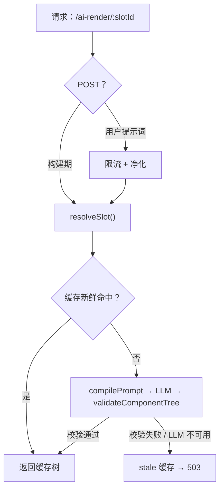

# @ai-slot/proxy

[English](https://github.com/iannil/ai-slot-component/blob/master/packages/proxy/README.md) | **简体中文**

> AI 渲染的页面内容——不泄漏 API 密钥、不放行无效 LLM 输出、不出现白屏。

**ai-slot-component** SDK 的服务端（[npm 包](https://www.npmjs.com/package/@ai-slot/proxy)）：一个无状态 handler，把 slot ID 变成**校验过的组件树**。接口是 Web 标准 `Request → Response`，可原样部署到 Cloudflare Workers、Deno、Bun、Vercel Edge 或普通 Node 服务。

```text
PromptCompiler → LLM Client（重试，8s 超时）→ OutputValidator → Cache（fresh → stale → 503）
```

延伸文档：[仓库 CLAUDE.md](https://github.com/iannil/ai-slot-component/blob/master/CLAUDE.md) · [总体设计](https://github.com/iannil/ai-slot-component/blob/master/docs/superpowers/specs/2026-09-24-ai-native-rendering-sdk-design.md)

## 安装

```bash
npm install @ai-slot/proxy
```

想在 monorepo 里动手开发？在仓库根目录运行 `pnpm install && pnpm build`，然后即可在任意 workspace 包中 `import ... from "@ai-slot/proxy"`。

## 公开数据交付（`createRenderHandler`）

`createRenderHandler` 面向公开、确定性的 GET 内容交付，不调用模型，也不需要 LLM 配置。服务端先用 `resolveSlot` 读取带版本的数据快照，再由 `provider.produce` 将快照映射为组件树；代理校验组件树后才返回。以下 `cms.example.com` 是说明域名，请替换为你固定的服务端数据源；不要把来访者提供的 URL 当成数据源。

```ts
import { defineRegistry } from "@ai-slot/registry";
import { createRenderHandler } from "@ai-slot/proxy";

const registry = defineRegistry({ components: {
  title: { description: "标题", props: { text: "string" }, required: ["text"] },
} });
export const handler = createRenderHandler({
  registry, registryVersion: "1", namespace: "public-homepage",
  resolveSlot: async (id, signal) => {
    if (id !== "hero") return null;
    const response = await fetch("https://cms.example.com/public/hero.json", { signal });
    if (!response.ok) throw new Error("数据源不可用");
    const data = await response.json();
    if (typeof data.version !== "string" || typeof data.title !== "string") throw new Error("数据源格式错误");
    return { slotId: id, originalContent: "原始标题", contentVersion: data.version, data: { title: data.title } };
  },
  provider: { id: "title-map-v1", produce: ({ slot }) => ({ component: "title", props: { text: slot.data?.title } }) },
});
```

此入口只接受 GET，且只用于公开内容；`resolveSlot` 与 `produce` 共用 8000ms 请求预算，并可通过 `AbortSignal` 取消。默认缓存新鲜期为 60000ms，默认 stale 窗口为 0。源内容变化时必须更新 `contentVersion`；映射逻辑变化时必须更新 `provider.id`。只有显式配置 `staleMs` 才会在生产失败时使用同一源版本的旧结果。传入的 registry 与配置应视为初始化后不变；需要修改时创建新 handler 并递增相应版本。数据源密钥只能保留在服务端，返回的 `data` 只应包含渲染所需的展示字段。

既有 `createAiRenderHandler`、LLM 调用、用户提示词和缓存行为保持原样；数据交付使用独立的 `createRenderHandler` 入口。

## 快速开始

```ts
import { createAiRenderHandler, createOpenAIClient } from "@ai-slot/proxy";
import { defineRegistry } from "@ai-slot/registry";

// 1. 声明 LLM 唯一允许输出的组件。
const registry = defineRegistry({
  components: {
    "hero-banner": {
      description: "Page hero section",
      props: { title: { type: "string", maxLength: 60 }, subtitle: { type: "string", maxLength: 120 } },
      required: ["title"],
    },
  },
});

// 2. 把 slot ID 映射到想要增强的原始页面内容。
const slots = new Map([
  ["hero", {
    slotId: "hero",
    originalContent: "<h1>Our product</h1><p>A plain product intro.</p>",
    developerPrompt: "Audience: developers. Emphasize the 5-minute integration.",
    contentVersion: "v1", // 递增即可失效 L1 缓存
  }],
]);

// 3. 组装 handler。密钥只留在这里——服务端。
const handler = createAiRenderHandler({
  registry,
  llm: createOpenAIClient({ apiKey: process.env.OPENAI_API_KEY! }),
  resolveSlot: (slotId) => slots.get(slotId) ?? null,
});

export default handler;
// 部署方式：Deno.serve(handler) · Bun.serve({ fetch: handler })
// · 或像 examples/plain-html/server.mjs 那样用 node:http 包一层
```

```bash
curl "http://localhost:8000/ai-render/hero"
```

```json
{
  "version": 1,
  "slot": "hero",
  "tree": { "component": "hero-banner", "props": { "title": "Ship AI-enhanced pages in 5 minutes" } },
  "meta": { "reason": "developer-prompt" }
}
```

返回的 `tree` 就是 [packages/runtime 的 `<ai-slot>`](https://github.com/iannil/ai-slot-component/tree/master/packages/runtime) 要渲染的内容；元素内的原始内容仍保留在页面上，作为兜底。

## 两条路径，同一个端点

| | `GET /ai-render/:slotId` | `POST /ai-render/:slotId` |
|---|---|---|
| 谁来调用 | 你，在构建期 | 终端用户，在运行时 |
| 提示词 | 开发者提示词，来自 `resolveSlot()` | 用户提示词，请求体 `{ "prompt": "..." }` |
| 缓存 | L1 —— 新鲜 1 小时，key = slot + `contentVersion` + `promptVersion` | L2 —— 新鲜 10 分钟，key = slot + 归一化后的提示词（trim/转小写/压缩空白，因此 "  Big   Title " 与 "big title" 共享同一条目） |
| 防护 | — | 每 IP 10 次/分钟（`x-forwarded-for`），提示词过滤至 ≤500 字符并去除控制字符 |
| 典型用途 | CI 中 `prewarm()`，然后静态托管 | `<ai-slot editable>` 实时改写 |

模型档位跟随路径：GET 用 `models.developer`（默认 `gpt-4o-mini`），POST 用 `models.user`——把便宜的模型留给实时用户流量。

## 为什么把 LLM 放上页面是安全的

- **模型从不输出 HTML。** 它只能组合你注册表里的组件；`validateComponentTree`（来自 `@ai-slot/registry`，与客户端运行时共享）强制校验组件名、props Schema、slot 嵌套、深度与节点数，其余一律丢弃。
- **密钥永远不会到达浏览器。** 所有 LLM 调用都发生在这个 handler 内部。
- **失败对用户不可见。** 重试一次 → 回退到 stale 缓存（1 天窗口）→ `503 ai_unavailable`。无论哪种情况，`<ai-slot>` 元素都保留原始内容：不白屏、不向终端用户报错。
- **用户提示词是不可信输入。** 先净化，再作为受限上下文注入——绝不作为指令——最终裁决权在 validator。
- **预算是强制的，不是许愿。** 8s 超时、`maxTokens` 上限（默认 2000）、每 IP 限流，以及用于计费/调优日志的 `onUsage` 钩子。

## 流式：先骨架，后终树

发送 `Accept: text/event-stream`，同一个端点会返回两帧 SSE——骨架帧由最终组件树派生，因此占位内容已经具备真实渲染的确切形状：

```text
event: skeleton
data: {"version":1,"slot":"hero","tree":{"component":"hero-banner","props":{"title":"","subtitle":""}},"meta":{"phase":"skeleton"}}

event: tree
data: {"version":1,"slot":"hero","tree":{...full tree...},"meta":{"reason":"developer-prompt"}}
```

客户端：`<ai-slot stream>`。缓存命中也会重新封装为 SSE，因此流式与缓存永远不会不一致。

## 在 CI 中预生成（"AI 静态页"）

```ts
const store = new MemoryCacheStore();
const handler = createAiRenderHandler({
  registry, llm, store, resolveSlot,
  developerTtlMs: 24 * 3600_000, staleMs: 7 * 24 * 3600_000,
});

const { ok, failed } = await prewarm(handler, ["hero", "pricing"]); // 单个 slot 失败不会中断其余
await writeFile("ai-cache.json", store.dump());
```

把 `ai-cache.json` 随构建一起发布，然后在启动时水合：

```ts
const store = MemoryCacheStore.load(await readFile("ai-cache.json", "utf8"), Date.now());
```

过期条目在加载时被丢弃；线上路径零额外代码即可继承预热的缓存。

## 数据变化时推送失效

`createInvalidationChannel()` 提供一个 SSE 端点和一个广播函数；触发时机由你决定（CMS webhook、定时任务 diff、管理后台路由）。

```ts
const invalidation = createInvalidationChannel(); // { handler, invalidate, subscriberCount }
// 把 GET /ai-invalidate 路由到 invalidation.handler
invalidation.invalidate("hero"); // → 向每个订阅者推送 event: invalidate / data: {"slot":"hero"}
```

支持 `?slot=<id>` 过滤，每 25s 一次 `: ping` 心跳（可通过 `heartbeatMs` 配置），订阅者断开即清理。客户端：`<ai-slot live live-src="/ai-invalidate">`。

## 工作原理



## API

### `createAiRenderHandler(opts)`

| 选项 | 类型 | 默认值 | 说明 |
|---|---|---|---|
| `registry` | `Registry` | — | 必填——组件白名单 |
| `llm` | `LLMClient` | — | 必填——任意 provider；已自动包上 `withRetry`（重试 1 次） |
| `resolveSlot` | `(slotId) => SlotSource \| null` | — | 必填——未知 slot 返回 `null` |
| `models` | `{ developer?, user? }` | `gpt-4o-mini` / `gpt-4o-mini` | 每条路径的模型档位 |
| `maxTokens` | `number` | `2000` | 每次调用的 token 预算 |
| `store` | `MemoryCacheStore` | 新建实例 | 传入以与 `prewarm()` 共享，或从磁盘水合 |
| `developerTtlMs` | `number` | `3_600_000` | L1 新鲜窗口 |
| `userTtlMs` | `number` | `600_000` | L2 新鲜窗口 |
| `staleMs` | `number` | `86_400_000` | stale 条目仍可作兜底返回的时长 |
| `rateLimit` | `{ limit, windowMs } \| false` | `{ 10, 60_000 }` | 仅 POST；进程内实现，多实例部署请换共享存储 |
| `onUsage` | `(entry: UsageLogEntry) => void` | — | 每次成功的 LLM 调用后触发；回调抛错会被吞掉 |
| `now` | `() => number` | `Date.now` | 可注入时钟，便于测试 |

错误是纯 JSON，每种失败模式都互不相同：

| 状态码 | `error` | 何时 |
|---|---|---|
| 400 | `invalid_prompt` | 用户提示词缺失/为空/超长 |
| 404 | `not_found` | 路径不是 `/ai-render/:slotId` |
| 404 | `unknown_slot` | `resolveSlot` 返回了 `null` |
| 405 | `method_not_allowed` | GET/POST 之外的方法 |
| 429 | `rate_limited` | POST 超过每 IP 限额 |
| 503 | `ai_unavailable` | LLM 失败或输出无效，且没有可用的 stale 缓存 |

### 自带模型

`LLMClient` 只有一个方法——指向 Anthropic、本地模型或 fixture 均可：

```ts
const llm = {
  async complete({ model, system, user, maxTokens }) {
    return { text: JSON.stringify({ version: 1, slot: "hero", tree: { component: "hero-banner", props: { title: "Hello" } } }) };
  },
};
```

`createOpenAIClient({ apiKey, baseUrl?, fetchImpl? })` 覆盖任意 OpenAI 兼容端点（DeepSeek、vLLM、网关），零 SDK 依赖，JSON 模式输出。

### 模块一览

| 模块 | 是什么 |
|---|---|
| `handler.ts` | `createAiRenderHandler`——路由、缓存、降级链、SSE 协商 |
| `cache.ts` | `MemoryCacheStore`（含 `dump`/`load`）、`prewarm` 缓存键、fresh/stale `lookup` |
| `prewarm.ts` | 基于开发者路径的 CI 预生成 |
| `prompt-compiler.ts` | 分层提示词：系统规则 → 注册表约束 → 开发者提示词 → 用户提示词（最窄的放最后） |
| `llm-client.ts` | `LLMClient` 接口、`LLMError`、`withRetry` |
| `openai-client.ts` | 基于 fetch 的 OpenAI 兼容适配器 |
| `sanitize.ts` | 用户提示词过滤器（类型、长度、控制字符） |
| `rate-limit.ts` | 进程内滑动窗口限流器 |
| `invalidate.ts` | `createInvalidationChannel`——SSE 失效推送 |

## 开发

```bash
pnpm --filter @ai-slot/proxy test        # 全部单元测试，无需访问网络
cd packages/proxy && npx vitest run src/handler.test.ts -t "降级"   # 单文件 / 单用例
pnpm --filter @ai-slot/proxy typecheck   # 干净 checkout 后需先运行 pnpm build
```

测试套件中的每个 LLM 都是 fixture 或 mock——这里没有任何真实 API 调用，因此可以放心用编码 agent 探索与修改本包。权威规格见[总体设计文档](https://github.com/iannil/ai-slot-component/blob/master/docs/superpowers/specs/2026-09-24-ai-native-rendering-sdk-design.md)。

## monorepo 全景

| 包 | 职责 |
|---|---|
| [`@ai-slot/registry`](https://github.com/iannil/ai-slot-component/tree/master/packages/registry) | 协议 + `OutputValidator`——安全边界，被 proxy、runtime 与构建工具共同消费 |
| **`@ai-slot/proxy`** | 本包——无状态渲染代理 |
| [`@ai-slot/runtime`](https://github.com/iannil/ai-slot-component/tree/master/packages/runtime) | 零依赖的 `<ai-slot>` 元素（`stream`、`live`、`editable`） |
| [`@ai-slot/adapter-dom`](https://github.com/iannil/ai-slot-component/tree/master/packages/adapter-dom) / [`adapter-react`](https://github.com/iannil/ai-slot-component/tree/master/packages/adapter-react) / [`adapter-vue`](https://github.com/iannil/ai-slot-component/tree/master/packages/adapter-vue) | 把校验过的组件树映射到你的真实组件 |
| [`examples/plain-html`](https://github.com/iannil/ai-slot-component/tree/master/examples/plain-html) | 端到端示例：存量页面、editable + streaming + live 槽位、Playwright e2e |
